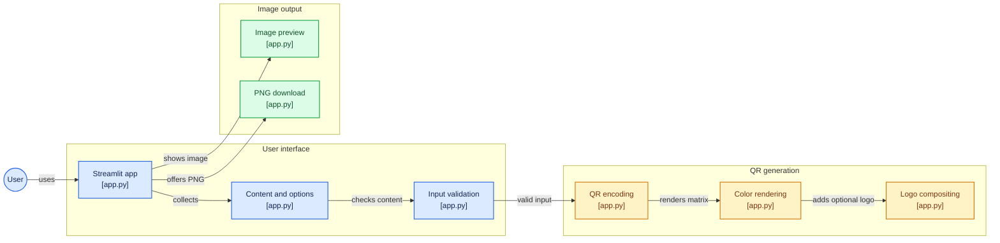

# 🔗 myQR
👉🏻 [](https://myqrneharoy3.streamlit.app/)

A simple, custom QR code generator built to explore **Streamlit** and **Pillow**. This app allows you to create scannable QR codes with custom colors and center-aligned logos.



## 🚀 How to Run

**Install dependencies:**
```bash
pip install -r requirements.txt
```

**Launch the app:**
   ```bash
   streamlit run app.py
```

## 🛠️ Built With

* **Streamlit**: For the web interface and reactive UI.
* **qrcode**: To generate the QR matrix.
* **Pillow (PIL)**: To handle image processing, logo resizing, and layering.

## 📌 Features

* **Custom Colors**: Pick any color for the QR pattern and background.
* **Branded Logos**: Upload a logo to place in the center of the QR code.
* **Smart UI**: The logo size slider only appears when a file is uploaded.
* **High Error Correction**: Uses `Level H` correction so the QR stays scannable even when covered by a logo.
---

Developed by [Neha Roy](https://github.com/neharoy3)
